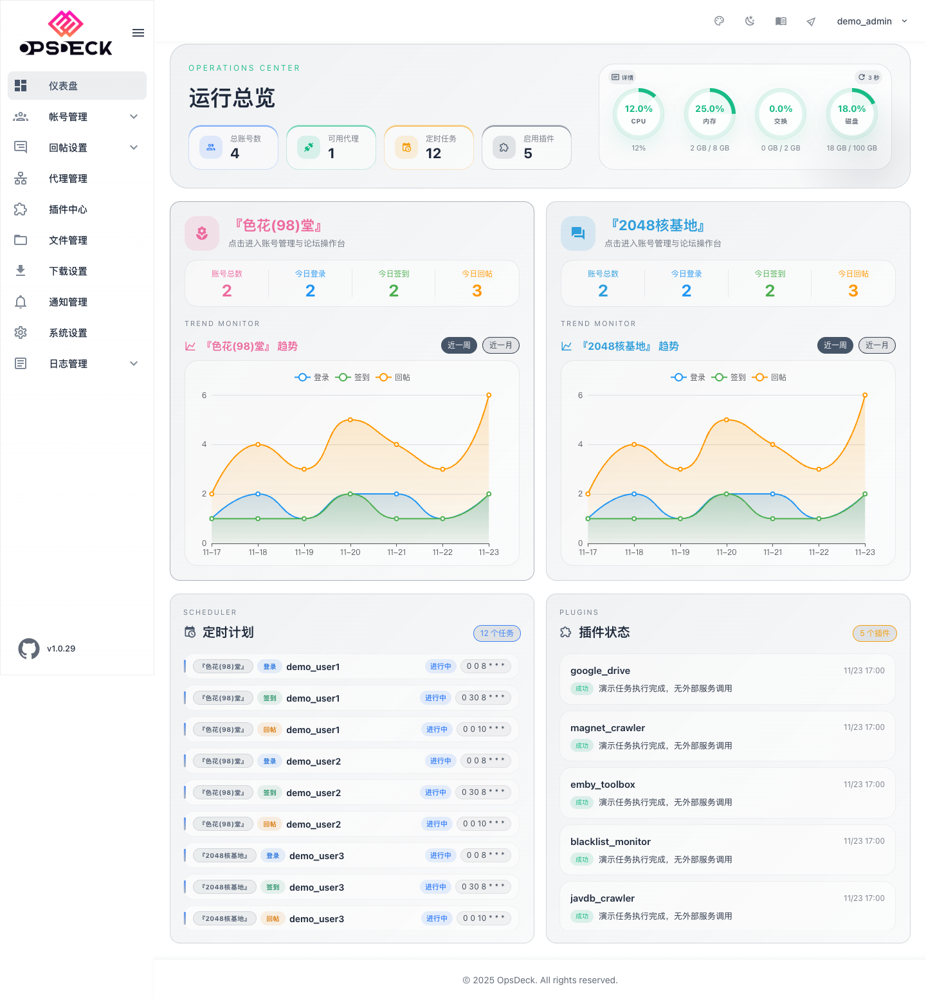

# OpsDeck-Rust

基于 Rust + Vue 3 的多账户操作控制台，集中管理论坛登录、签到、回帖、定时任务、插件与运行日志。

[下载 OpsDeck](https://github.com/xiarenyyds/OpsDeck-Rust/releases/latest) · [安装与部署](docs/installation.md) · [界面图解](docs/ui-guide.md) · [历史版本](https://github.com/xiarenyyds/OpsDeck-Rust/releases)

<details>
<summary>运行总览</summary>



</details>

## 功能

- 论坛账号登录、签到、回帖与定时任务。
- OpenAI / Gemini 回复与验证码识别，使用能力取决于授权和配置。
- Telegram 通知与交互机器人。
- Google Drive、色花磁力爬虫、Emby 等插件工具。
- Cookie 会话、Authenticator 2FA、系统日志和在线更新。

## 快速启动

```bash
docker run -d --name opsdeck -p 13113:13113 \
  -v "$(pwd)/data:/app/data" --restart unless-stopped xrbzy/opsdeck:latest
```

打开 `http://localhost:13113`，按向导创建账户并绑定 Authenticator。
持久化目录 `data` 同时保存业务数据和在线更新状态。Compose、二进制依赖、备份与升级步骤见 [安装说明](docs/installation.md)。

## 下载与更新

提供 Linux x64、Linux ARM64 和 macOS Apple 芯片构建，附件以具体版本的 Releases 为准。程序更新通过本仓库的 GitHub Release API 获取正式版本，并验证资产 digest。

本仓库保存用户文档与发布附件。每个版本的变更见 [Releases](https://github.com/xiarenyyds/OpsDeck-Rust/releases) 对应说明。
